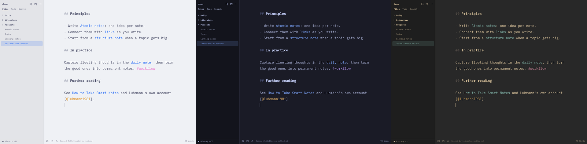

# OmaZettel

**Zettelkasten notes for [Omarchy](https://omarchy.org), in plain Markdown files.**

OmaZettel is a native Qt/QML notes app for linking ideas: `[[wiki links]]`,
backlinks, tags, note templates, search, pandoc export with citations, and git
sync with version history. Your notes stay ordinary `.md` files in a folder you
choose, so VS Code, Neovim, git and pandoc keep working on them too. Its colors
follow your Omarchy theme, the way Neovim and VS Code do.


OmaZettel is an independent fork of [Omawrite](https://github.com/omacom/omawrite)
by David Heinemeier Hansson, extended into a notes system. It is not made or
endorsed by Omacom or the Omarchy project.

> **Status: 0.6.0, early.** Everything below works and is covered by tests, but
> OmaZettel is young: expect rough edges, and keep your notes folder in git or
> another backup. Bug reports and ideas are welcome in the issues.

## Contents

- [Features](#features)
- [Install](#install)
- [Getting started](#getting-started)
- [Writing](#writing)
- [Links, backlinks and tags](#links-backlinks-and-tags)
- [Note templates](#note-templates)
- [Search and outline](#search-and-outline)
- [Export](#export)
- [Citations](#citations)
- [Sync and history](#sync-and-history)
- [Colors and themes](#colors-and-themes)
- [Keyboard shortcuts](#keyboard-shortcuts)
- [Where things are kept](#where-things-are-kept)
- [Building from source](#building-from-source)
- [Contributing](#contributing)
- [Credits and license](#credits-and-license)

## Features

- **A notes folder, not a database.** A sidebar of your folders and Markdown
  notes: create, rename, move by drag and drop, move to trash.
- **Links that keep working.** `[[Note]]`, `[[folder/Note]]`, `[[Note#Heading]]`
  and `[[Note|label]]`, with completion as you type `[[`. Following a link to a
  note that doesn't exist creates it. Renaming or moving a note rewrites every
  link to it.
- **Backlinks, tags and an outline** for the open note in a side panel, and a
  Tags view of the whole folder.
- **Note templates** (Note, Meeting, Daily, Literature note, or your own) with
  placeholders and a pandoc YAML header, so notes export with the right title,
  author and date. Ctrl+Shift+D opens today's daily note.
- **Search across notes** with phrases and tag filters, ignoring case and
  accents, plus **Ctrl+O** to jump to any note by name and a **command palette**
  (Ctrl+Shift+P).
- **Export with pandoc** to PDF, Word, OpenDocument, HTML, LaTeX and anything
  else pandoc writes, using your own templates and reference documents. Export
  one note or a whole folder as one document.
- **Citations** from a BibTeX or CSL JSON bibliography (Zotero's Better BibTeX
  works well), with `[@key]` completion and a formatted reference list on export.
- **Git sync and version history**: sync with any git remote or a private
  GitHub repository you create in one click, resolve conflicts side by side,
  and see or restore any earlier version of a note. Conflict copies from
  Syncthing, Nextcloud and Dropbox are spotted and resolved the same way.
- **Your theme's colors**, through an Omarchy theme template, or the fixed
  Oma palette shared with OmaShow and the other Oma apps.
- From Omawrite: a calm editor that hides Markdown markers away from the caret,
  auto-save, crash recovery, and warnings when a file changes underneath you.

## Install

OmaZettel is built for Omarchy and Arch Linux. Clone it and run the installer,
which builds the app and installs it as a package with pacman (it asks for your
password):

```sh
git clone https://github.com/mcsmith3/omazettel.git
cd omazettel
./bin/install
```

It needs `qt6-base`, `qt6-declarative` and `xdg-desktop-portal`, which Omarchy
already has, plus `gcc` and `make` to build. Some features use other programs,
installed only if you want them:

| For | Install |
| --- | --- |
| Export to PDF, Word, HTML, … | `sudo pacman -S pandoc-cli` |
| PDF export (any font, any language) | `sudo pacman -S texlive-xetex` (or `texlive-latex` for pdflatex) |
| Version history and sync | `sudo pacman -S git` |
| Creating a GitHub repository to sync with | `sudo pacman -S github-cli`, then `gh auth login` and `gh auth setup-git` |
| Editing Word and OpenDocument styles | `sudo pacman -S libreoffice-fresh` |

To update later, `git pull` and run `./bin/install` again. To remove it,
`sudo pacman -R omazettel`; your notes are untouched.

## Getting started

1. Open **OmaZettel** from the app launcher.
2. Click **Choose folder…** and pick a folder of Markdown notes, or an empty
   folder to start one. OmaZettel reopens it, at the note you had open, next time.
3. Press **Ctrl+N** for a new note, pick a template, and give it a title.
4. Type `[[` to link to another note. Ctrl+click a link to follow it.
5. Press **Ctrl+Shift+P** for every command, and **Ctrl+,** for settings.

To make OmaZettel the default app for Markdown files:

```sh
xdg-mime default omazettel.desktop text/markdown text/x-markdown
```

## Writing

- Markdown markers (`**`, `_`, `` ` ``, link addresses) fade away when the caret
  is elsewhere and come back when you edit them. Headings, lists, quotes and
  code blocks are styled as you type.
- Once a note has a file, edits are saved a moment after you stop typing, so
  Ctrl+S is rarely needed. Untitled drafts are never saved behind your back, but
  are recovered after a crash.
- If another app changes the open note, OmaZettel asks before replacing your
  text, and stops auto-saving until you choose.
- Ctrl+B, Ctrl+I and Ctrl+Shift+X toggle bold, italic and strikethrough; Ctrl+K
  inserts a link; Tab and Shift+Tab indent list items; Enter continues lists.
- The **A** button in the footer picks the writing font (IBM Plex Mono by
  default). Text follows `omarchy display text size`, and Ctrl+= / Ctrl+- /
  Ctrl+scroll change it on top of that.

## Links, backlinks and tags

- **Link** with `[[Note name]]`, `[[folder/Note]]`, `[[Note#Heading]]`,
  `[[#Heading]]` (in the same note) or `[[Note|label]]`, which reads as just
  "label". Typing `[[` suggests notes; Up, Down and Enter pick one.
- **Follow** a link with Ctrl+click, or Ctrl+Enter with the caret in it. Web
  links open in the browser. Alt+Left and Alt+Right go back and forward.
- **Links to new notes** create those notes when the note is saved, next to it
  or at the path the link names, from the Note template. The link you are still
  typing waits. Turn this off in Settings to create notes only on Ctrl+click.
- **Renaming or moving** a note, or a folder of notes, updates every link to it
  and keeps `#heading` and `|label`. The status bar says how many links changed.
- **Tag** with `#tag` (nested: `#project/client`), or `tags: [a, b]` or
  `keywords:` in the YAML header.
- The **right panel** (Ctrl+Shift+B) shows the open note's outline, its tags,
  and its **backlinks**: every note that links to it, with the line it's on.
  The sidebar's **Tags** tab lists every tag with its count.
- The note index notices edits made in other apps when you switch back.

## Note templates

**Ctrl+N** asks for a template and a title; OmaZettel remembers the template you
used last. **Ctrl+Shift+D** opens today's daily note, making it the first time.

Templates are Markdown files in `.omazettel/note-templates/` inside your notes
folder; OmaZettel adds **Note** (a Zettelkasten note with an ID), **Meeting**,
**Daily** and **Literature note** the first time. Edit them from … →
Edit note templates, or add your own. Each starts with a pandoc YAML header:

```markdown
<!-- omazettel: name="{{date}} {{title}}" folder="Meetings" -->
---
title: "{{title}}"
author: "{{author}}"
date: "{{date}}"
tags: [meeting]
---

## Agenda

- {{cursor}}
```

- **Placeholders:** `{{title}}`, `{{author}}` (set in Settings),
  `{{date}}`, `{{date:dddd d MMMM yyyy}}` (any Qt date format), `{{time}}`,
  `{{datetime}}`, `{{weekday}}`, `{{id}}` (yyyyMMddHHmmss), `{{folder}}` and
  `{{cursor}}`, where typing starts. Values in the YAML header are escaped.
- **The first line** (optional, left out of the note) sets the file `name`
  (default `{{title}}`), the `folder` it goes in, and `existing="open"` to open a
  note of that name instead of making a second one, as the Daily template does.
- A template that doesn't use `{{title}}` doesn't ask for one.

## Search and outline


- **Ctrl+Shift+F** searches every note. Words must all appear, in any order;
  `"quoted phrases"` match as written; `#tag` or `tag:name` keeps notes with
  that tag or one under it. Case and accents don't matter. Title matches come
  first, each note shows its matching lines, and clicking one opens the note
  with the match selected.
- **Ctrl+O** jumps to a note by name (Enter on a new name creates it), and
  **Ctrl+F** / **Ctrl+H** find and replace within the note.
- The **outline** in the right panel follows your headings as you type and
  marks the section you're in; click one to go there.

## Export


**Ctrl+Shift+E** (or right-click a note → Export…) exports with
[pandoc](https://pandoc.org). Pick a profile and where to save. The note's YAML
header fills in the title, author and date; `[[links]]` become their text;
unsaved changes are included.

The setup follows Zettlr's custom templates and reference documents, but uses
pandoc's own files, so the same export works from a terminal:

- **Profiles** are pandoc [defaults files](https://pandoc.org/MANUAL.html#defaults-files)
  in `.omazettel/export/`: PDF, Word, OpenDocument, HTML and LaTeX source to
  start with. Any pandoc option works (`toc: true`, `number-sections: true`,
  `variables:`, …). **Edit** opens one; **New…** copies it.
- **Templates** (`.tex`, `.html`) lay out PDF and HTML exports; **reference
  documents** (`.docx`, `.odt`, `.pptx`) carry Word, LibreOffice and PowerPoint
  styles. **New ▾** makes one from pandoc's default in `.omazettel/templates/`,
  and **New profile with this** makes a profile that uses it.
- From a terminal: `pandoc -d .omazettel/export/PDF.yaml note.md -o note.pdf`.

**Export a folder** (right-click a folder → Export folder…) to make one document
from all its notes and subfolders, like a Zettlr project: untick notes, reorder
them, and give it a title and author. Each note's title becomes a chapter
heading. Choices are saved in the folder's `.omazettel-project.yaml`.

Exports are saved next to the note, or, if you choose in Settings, in an
`Exports` folder that is kept out of git sync.

PDF export needs a LaTeX engine. The PDF profile uses XeLaTeX when
`texlive-xetex` is installed (any font, any script), and pdflatex otherwise.

## Citations

In … → **Citations…**, choose a bibliography (BibTeX `.bib` or CSL JSON, such as
the file Zotero's Better BibTeX keeps exported; OmaZettel reloads it when it
changes) and, if you like, a citation style (`.csl`, from the
[Zotero Style Repository](https://www.zotero.org/styles); pandoc's default is
Chicago author-date).

Cite with `[@key]`, `[@key, p. 4]` or `[see @one; @two]`. Typing `[@` suggests
references by key, author, year or title. Exports of notes that cite something
format the citations and add a reference list. A note may also name its own
`bibliography:` in its header.

## Sync and history

Your notes stay plain files on your computer. To keep them on other devices, or
share them with a few people taking turns, OmaZettel has git built in (… →
**Sync & history…**, or click the status line at the foot of the sidebar):

1. **Turn on version history.** Every version of every note is kept with git.
2. **Add a remote**: paste any git address, or click **Create** to make a
   private GitHub repository with the GitHub CLI. Git uses your usual login
   (`gh auth setup-git` or an SSH key) and never stops to ask for a password; a
   login problem shows as a message with a hint.
3. **Sync** happens when OmaZettel starts, every 5 minutes (adjustable), and on
   **Ctrl+Alt+S** or the sync button. It saves your changes as a version,
   merges the other side's (never rewriting history) and sends yours. The open
   note is saved first and reloads quietly if the sync changed it.

**Conflicts.** When the same note changed on two devices, the sync stops and
lists it. **Compare…** shows both versions line by line; choose **Keep mine**,
**Keep theirs**, **Keep both** (theirs saved beside it as
"Note (other version).md"), or **Edit** the note to combine them and click
**Done editing**. **Undo the merge** leaves everything as it was.

**History.** Right-click a note → **History…** lists its saved versions,
compares any of them with the note as it is now, and restores one (Ctrl+Z takes
it back).

**Syncthing, Nextcloud, Dropbox or ownCloud** work too: point them at the notes
folder. The conflict copies they leave (`Note.sync-conflict-….md`,
`Note (conflicted copy …).md`, …) are kept out of links and search, listed in
Sync & history, and resolved the same way.

OmaZettel does not edit a note live alongside someone else. People take turns
and sync, and the conflict screen handles the occasional clash.

On another computer, clone the repository and choose that folder in OmaZettel:

```sh
git clone https://github.com/you/notes.git ~/Notes
```

## Colors and themes



OmaZettel follows your Omarchy theme the way Neovim, VS Code and the terminals
do: switch themes and it recolors at once, light themes included. Every color
it uses has a name (`editor.background`, `editor.heading`, `editor.link`,
`editor.wikilink`, `editor.tag`, `editor.citation`, `editor.code`, `ui.panel`,
`ui.border`, `ui.accent`, …), and the names are set by an `omazettel.toml` theme
file in Omarchy's template format:

```toml
[editor]
background = "{{ background }}"
link = "{{ blue }}"
tag = "{{ magenta }}"
citation = "{{ yellow }}"
search = "{{ mix background yellow 35% }}"

[ui]
panel = "{{ dark_background }}"
border = "{{ mix background foreground 18% }}"
```

The colors come from the first of these that exists:

1. **The theme's own `omazettel.toml`**, in the theme's folder. Theme authors can
   ship one, as they do `neovim.lua` or `vscode.json`. Omarchy also writes it
   when you switch themes if you have a template in `~/.config/omarchy/themed/`.
2. **Your template**, `~/.config/omarchy/themed/omazettel.toml.tpl`, used for
   every theme. Settings → **Customize theme colors…** creates it from the
   built-in one and opens it; OmaZettel picks up each save at once.
3. **The built-in template** ([`themed/omazettel.toml.tpl`](themed/omazettel.toml.tpl),
   also installed to `/usr/share/omazettel/themed/`), filled with the current
   theme's colors.

`{{ name }}` is any color the theme defines (`background`, `foreground`,
`accent`, `red` … `magenta`, `lighter_background`, `selection_background`,
`color0`–`color15`, …), `{{ mix a b 30% }}` mixes two, and `"#rrggbb"` sets one
directly. Names a file leaves out get sensible defaults.

Prefer one look everywhere? Settings → **Oma palette** uses the fixed dark
palette of OmaShow and the other Oma apps, keeping only the theme's accent.

## Keyboard shortcuts

Press **F1** in the app for the full list.

| Keys | Action |
| --- | --- |
| Ctrl+Shift+P | Command palette |
| Ctrl+, | Settings |
| Ctrl+N | New note (from a template) |
| Ctrl+Shift+D | Today's daily note |
| Ctrl+O | Go to note |
| Ctrl+Shift+F | Search all notes |
| Ctrl+F / Ctrl+H | Find / find and replace in the note |
| Ctrl+click, Ctrl+Enter | Follow a link |
| Alt+Left / Alt+Right | Back / forward |
| Ctrl+Shift+E | Export with pandoc |
| Ctrl+Alt+S | Sync now |
| Ctrl+\ | Show or hide the sidebar |
| Ctrl+Shift+B | Show or hide outline, tags and backlinks |
| Ctrl+Shift+O | Open any file |
| Ctrl+Shift+N | New window |
| Ctrl+B / Ctrl+I / Ctrl+K | Bold / italic / link |
| Ctrl+= / Ctrl+- / Ctrl+0 | Text size |
| Ctrl+P | Print |
| F11 or Super+F | Full screen |

## Where things are kept

Everything about your notes lives in the notes folder, so it syncs with them:

| Path (in the notes folder) | What |
| --- | --- |
| `*.md`, subfolders | Your notes |
| `.omazettel/note-templates/` | Note templates |
| `.omazettel/export/` | Export profiles (pandoc defaults files) |
| `.omazettel/templates/` | Export templates and reference documents |
| `.omazettel/citations.yaml` | Bibliography and citation style |
| `<folder>/.omazettel-project.yaml` | A folder export's notes, order and profile |
| `Exports/` | Exports, if you chose that in Settings (git-ignored) |

App settings (window, recent folders, author, sync timing) are in
`~/.config/omazettel/omazettel.conf`.

`omazettel FILE` opens a file; with no arguments OmaZettel reopens your notes
folder at the last note. `omazettel --help` and `--version` answer in the
terminal.

## Building from source

You need Qt 6 (`qt6-base`, `qt6-declarative`), a C++17 compiler and `make`.

```sh
./bin/build            # builds ./build/omazettel
./bin/test             # runs the tests (offscreen; no display needed)
./build/omazettel      # runs the build
./bin/install          # builds and installs the Arch package
```

The tests cover the editor (from Omawrite) and OmaZettel's notes features,
including real pandoc exports and two devices syncing through a git remote.

The code is laid out so changes from upstream Omawrite merge cleanly:
OmaZettel's additions live in their own files (`src/vault.*`,
`src/noteindex.*`, `src/zettel.*`, `src/exporter.*`, `src/sync.*`,
`src/apptheme.*`, `src/backend_notes.cpp`, `src/markdownhighlighter_notes.cpp`
and the QML panels and dialogs), with small hooks in Omawrite's files.
`docs/PLAN.md` records how it was built.

## Contributing

Issues and pull requests are welcome. Please:

- describe what you expected and what happened, with your Omarchy version
  (`omarchy version`) for bugs;
- run `./bin/test` before sending a pull request, and add a test for new
  behavior where you can;
- keep additions out of Omawrite's own files when possible, so upstream
  merges stay simple.

## Credits and license

OmaZettel is licensed under the GNU General Public License, version 3 or later
(`GPL-3.0-or-later`); see [`LICENSE`](LICENSE).

It started from [Omawrite](https://github.com/omacom/omawrite) by David
Heinemeier Hansson, under the MIT license
([`LICENSES/MIT-omawrite.txt`](LICENSES/MIT-omawrite.txt)). Feature ideas
inspired by [Zettlr](https://www.zettlr.com), [Obsidian](https://obsidian.md)
and [Joplin](https://joplinapp.org). The Oma palette comes from
[OmaShow](https://github.com/28allday/omashow). The bundled
IBM Plex Mono font is under the SIL Open Font License 1.1
([`fonts/OFL.txt`](fonts/OFL.txt)). See
[`THIRD-PARTY-NOTICES.md`](THIRD-PARTY-NOTICES.md) for details.
