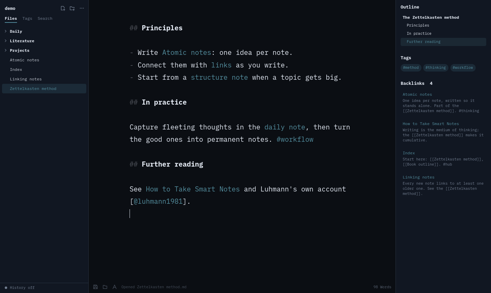
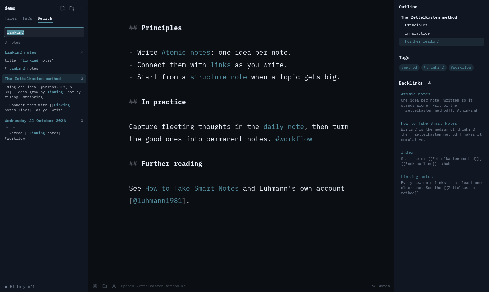
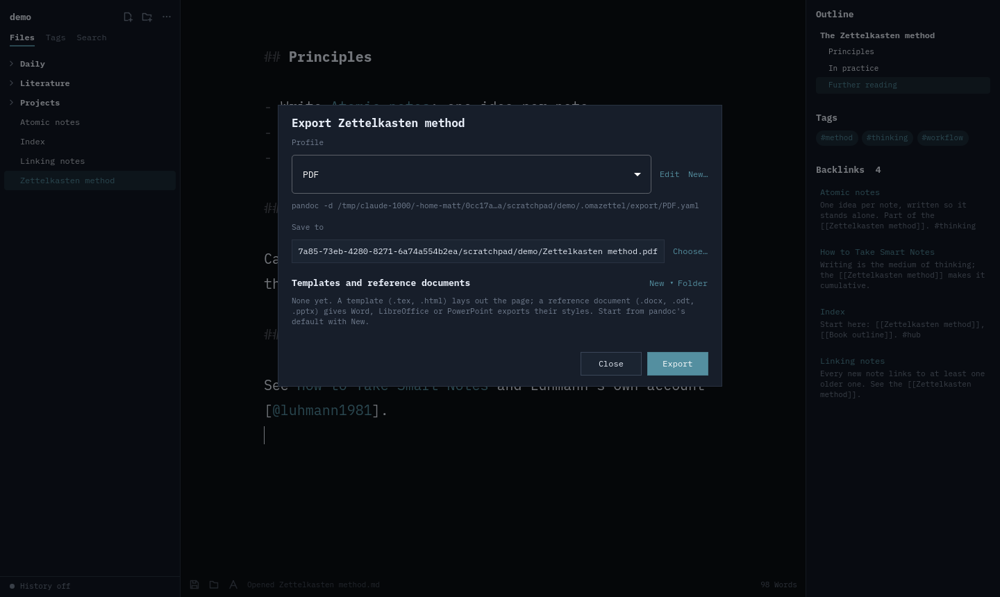

# OmaZettel

A Zettelkasten notes app for Omarchy that works on a folder of plain Markdown
files. It's built with Qt Quick and C++ and follows your Omarchy theme.

OmaZettel is an independent fork of [Omawrite](https://github.com/omacom/omawrite)
by David Heinemeier Hansson. It is not made or endorsed by Omacom or the
Omarchy project.



> **Status: 0.5.0, early but complete.** Working: the notes folder sidebar,
> `[[wiki links]]`, backlinks, tags, note templates, pandoc export with
> custom templates, folder export, citations, search across notes and an
> outline, in the shared Oma colour palette, with git sync, version history
> and conflict handling. Still to come: polish and packaging. See `docs/PLAN.md`.

## Sync and history

Notes stay plain files in a folder on this computer. To keep them on other
devices, or share them with a few people taking turns, use either:

**Git, built in** (… menu → Sync & history…, or click the status line at the
bottom of the sidebar):

- **Turn on version history** saves every version of every note with git.
  With no remote, that is version history on this computer only.
- **Add a remote** to sync: any git address, or **Create** a private GitHub
  repository with the GitHub CLI (`gh`) in one click. Git uses your normal
  login (`gh auth login` then `gh auth setup-git`, or an SSH key) and never
  stops to ask for a password; a missing login shows as an error with a hint.
- **Syncing** saves this device's changes as a version, merges in the other
  side's (never rewriting history), and sends this side's. It runs when
  OmaZettel starts, every 5 minutes (adjustable), and on Ctrl+Alt+S or the ⟳
  button. The open note is saved first, and reloads quietly if the sync
  changed it (you are asked only if you were typing at the same moment).
- **Conflicts**: when a note changed on both sides since the last sync, the
  sync stops and lists it. **Compare…** shows both versions line by line;
  choose **Keep mine**, **Keep theirs** or **Keep both** (theirs is saved
  beside it as "Note (other version).md"), or **Edit** the note to combine the
  two and click **Done editing**. **Undo the merge** leaves everything as it
  was here. The sync then finishes and sends the result.
- **History** (right-click a note → History…): every saved version, newest
  first, compared with the note as it is now. **Restore this version** puts it
  back in the editor (Ctrl+Z takes it back).

**Syncthing, Nextcloud, Dropbox or ownCloud**: point it at the notes folder.
When a note changes on two devices at once, those tools leave a conflict copy
(`Note.sync-conflict-…md`, `Note (conflicted copy …).md`, …). OmaZettel keeps
copies out of links, search and tags, lists them in Sync & history, and
resolves them the same way: keep the original, keep the copy (the original
goes to the trash) or keep both.

Nothing here edits a note live alongside someone else; for that, people take
turns and sync.

## Look

OmaZettel uses the shared Oma palette (as in OmaShow and the other Oma apps):
a fixed dark surround, with the accent from your Omarchy theme. Turn it off in
the sidebar's … menu → Oma color palette to take every colour from the Omarchy
theme instead, as Omawrite does.

## Notes folder

Choose a folder of Markdown notes from the sidebar (or its `…` menu). The
sidebar shows the folder's `.md` and `.markdown` files and subfolders; hidden
folders such as `.git` stay out of view. Notes stay ordinary files, so you can
keep editing the same folder in VS Code, track it with git or run pandoc on it.

- Click a note to open it in place. A note you were just editing is saved
  first, the same way auto-save would have saved it.
- Right-click a note or folder for New note here, New folder here, Rename and
  Move to trash. Trashed notes go to the desktop trash, not deleted outright.
- Drag a note or folder onto a folder to move it there, or onto the empty
  space below the tree to move it to the top. Click a folder first to make
  new notes in it.
- Drag the sidebar's right edge to resize it.
- OmaZettel remembers the folder, recent folders and the last open note.

## Note templates

New notes (Ctrl+N or the sidebar's new-note button) start from a template you
pick; OmaZettel remembers the last one. Ctrl+Shift+D opens today's daily note,
making it the first time.

Templates are Markdown files in `<notes folder>/.omazettel/note-templates/`.
The first time you make a note, OmaZettel adds four: **Note** (a Zettelkasten
note with an ID), **Meeting**, **Daily** and **Literature note**. Edit them, or
add your own, from the sidebar's `…` menu → Edit note templates, or in any
editor. Each starts with a pandoc YAML header (title, author, date, tags, …),
so notes export with the right metadata.

Placeholders: `{{title}}`, `{{author}}` (set it in the `…` menu; defaults to
your account's full name), `{{date}}`, `{{date:dddd d MMMM yyyy}}` (any Qt date
format), `{{time}}`, `{{datetime}}`, `{{weekday}}`, `{{id}}` (yyyyMMddHHmmss),
`{{folder}}` and `{{cursor}}` (where typing starts). In the YAML header, values
are escaped so quotes in a title stay valid.

An optional first line sets how the note is made, and is left out of it:

```
<!-- omazettel: name="{{date}} {{title}}" folder="Meetings" existing="open" -->
```

`name` is the file name (default `{{title}}`), `folder` is where it goes
inside the notes folder (default: the selected folder) and `existing="open"`
opens a note of that name instead of making a second one (the Daily template
uses it). A template that doesn't use `{{title}}` doesn't ask for one.

## Citations

Point OmaZettel at a bibliography in … menu → Citations…: a BibTeX (`.bib`)
or CSL JSON file, such as the one Zotero's Better BibTeX keeps exported (it
reloads when the file changes), and optionally a citation style (`.csl`, for
example APA from the [Zotero Style Repository](https://www.zotero.org/styles);
pandoc's default is Chicago author-date). Both are saved in
`.omazettel/citations.yaml`, relative to the notes folder when inside it.

Cite with `[@key]`, `[@key, p. 4]` or `[see @one; @two]`; typing `[@` suggests
references by key, author, year or title. Citations show in the accent.
Exports of notes that cite something run pandoc's citeproc, which formats the
citations and adds the reference list. A note can also name its own
`bibliography:` in its YAML header.

## Search and outline



- Ctrl+Shift+F opens the sidebar's Search tab (with the selected text, if
  any). Words find notes containing all of them, `"quoted phrases"` match as
  written, and `#tag` or `tag:name` keeps notes with that tag or one under it.
  Case and accents don't matter. Notes with a match in the title come first;
  each shows up to three matching lines. Click one to open the note with the
  match selected; Enter in the field opens the first.
- The right panel's Outline lists the open note's headings as you type and
  marks the section the caret is in. Click one to go there.
- `[[Note#Heading]]` opens the note at that heading, and `[[#Heading]]` jumps
  to a heading in the same note.

## Export



Ctrl+Shift+E (or right-click a note → Export…) exports the note with
[pandoc](https://pandoc.org). Pick a profile and where to save, then Export.
The open note exports what is in the editor, unsaved changes included.
`[[links]]` become their text, since links between notes mean nothing in a
PDF; the note's YAML header (title, author, date, …) fills the document.

How it is set up, after Zettlr's custom templates and reference documents,
but as pandoc's own files so the same export also works from a terminal:

- **Profiles** are pandoc [defaults files](https://pandoc.org/MANUAL.html#defaults-files)
  in `<notes folder>/.omazettel/export/`. OmaZettel adds PDF, Word,
  OpenDocument, HTML and LaTeX source the first time you export. Any pandoc
  option works in them (`toc: true`, `number-sections: true`, `variables:`,
  `citeproc: true`, …). Click Edit in the export dialog to change one, or New
  to copy it.
- **Templates** (`.tex`, `.html`) lay out PDF and HTML exports, and
  **reference documents** (`.docx`, `.odt`, `.pptx`) give Word, LibreOffice
  and PowerPoint exports their styles. They live in `.omazettel/templates/`.
  New ▾ in the export dialog makes one from pandoc's default; edit a template
  in OmaZettel, or open a reference document in LibreOffice or Word and change
  its styles. **New profile with this** makes a profile that uses it.
- Profiles point to templates with `${.}/../templates/<file>` (`${.}` is the
  profile's folder), so from a terminal:
  `pandoc -d .omazettel/export/PDF.yaml note.md -o note.pdf`.

**Export a folder** (right-click a folder → Export folder…, or … menu →
Export the whole notes folder…) to make one document from all its notes,
subfolders included, like a Zettlr project. Untick notes to leave them out,
reorder with ↑ ↓, and give the document a title and author. Each note's YAML
header is dropped and its title becomes a chapter heading. The order, choices
and profile are saved in the folder's `.omazettel-project.yaml`; notes added
later are appended.

PDF export needs a LaTeX engine. The PDF profile uses XeLaTeX when it's
installed (`sudo pacman -S texlive-xetex`, which handles any Unicode text and
system fonts) and pdflatex otherwise.

## Links and tags

- Link notes with `[[Note name]]`. `[[folder/Note]]`, `[[Note#Heading]]` and
  `[[Note|label]]` work too; a labelled link shows only its label until the
  caret is in it. Typing `[[` suggests notes; Up, Down and Enter
  pick one.
- Ctrl+click a link, or put the caret in it and press Ctrl+Enter, to open it.
- A link to a note that doesn't exist yet gets that note made when the note
  is saved (auto-save included), next to the linking note or at the path the
  link names, from the Note template. The link the caret is still in waits,
  so half-typed names don't become notes.
- Renaming or moving a note, or a folder of notes, updates every `[[link]]`
  to it, keeping `#heading` and `|label`. Path links (`[[folder/Note]]`) get
  the new path. The status bar says how many links changed. Web links open in the browser. Alt+Left and Alt+Right go back and
  forward.
- Tag notes with `#tag` (nested tags like `#project/client` work), or with
  `tags: [a, b]` or `keywords:` in YAML front matter.
- The right panel (Ctrl+Shift+B) shows the open note's tags and its
  backlinks: every note that links to it, with the line it does so on.
- The sidebar's Tags tab lists every tag with its count; open one to see its
  notes.
- Ctrl+O jumps to any note by name; Enter on a name with no match creates it.
- The index rescans after changes in the sidebar, on save, and whenever you
  come back to the window, so edits made in other apps show up too.

## Install

On Arch or Omarchy, from this checkout:

```sh
./bin/install
```

That builds OmaZettel and installs the package with pacman (it asks for your
password). Optional extras: `pandoc-cli` for export, `texlive-xetex` for PDF,
`git` and `github-cli` for sync. Then open OmaZettel from the app launcher,
choose a notes folder, and press **Ctrl+Shift+P** for every command or
**Ctrl+,** for settings.

## Command line

`omazettel` opens an empty document and `omazettel FILE` opens a Markdown file.
`omazettel --help` and `omazettel --version` answer in the terminal without opening a window.

## Shortcuts

- `Ctrl+S` saves. Unsaved documents use the XDG desktop portal file picker.
- `Ctrl+Shift+S` saves as.
- `Ctrl+O` goes to a note in the notes folder (or opens a file when no folder is open).
- `Ctrl+Shift+O` opens any Markdown file through the portal picker.
- `Ctrl+P` opens the system print dialog.
- `Ctrl+N` makes a new note in the notes folder.
- `Ctrl+Shift+N` opens a new OmaZettel window.
- `Ctrl+Shift+D` opens today's daily note.
- `Ctrl+Shift+E` exports the note with pandoc.
- `Ctrl+Shift+F` searches all notes.
- `Ctrl+Alt+S` syncs now (or saves a version, without a remote).
- `Ctrl+Shift+P` opens the command palette; `Ctrl+,` opens settings.
- `Ctrl+\` shows or hides the notes sidebar.
- `Ctrl+Z`, `Ctrl+Shift+Z`, and `Ctrl+Y` handle undo and redo.
- `Super+F` toggles fullscreen. Qt maps this key as `Meta+F`.
- `Ctrl+F` searches the document. Use `Enter` or `Ctrl+G` for the next match and `Shift+Enter` for the previous match.
- `Ctrl+H` opens find and replace.
- `Ctrl+B`, `Ctrl+I`, and `Ctrl+Shift+X` toggle bold, italic, and strikethrough Markdown. `Ctrl+K` inserts a link.
- `Ctrl+=` and `Ctrl+-` change the text size, `Ctrl+0` returns to the default.
  `Ctrl+scroll` does the same.
- `Ctrl+Shift+C` copies the rendered document as HTML, with plain text as a fallback.
- `Ctrl+?`, `Ctrl+/`, or `F1` shows the keyboard shortcut reference.
- In the unsaved-changes dialog, `Alt+C`, `Alt+D`, and `Alt+S` choose Cancel,
  Discard, and Save.

Once a document has been saved to a file, edits are auto-saved to that file a
moment after you stop typing, so `Ctrl+S` is rarely needed. Untitled drafts are
never auto-saved — they wait for an explicit save so OmaZettel never picks a file
name for you. Unsaved drafts are recovered after an abnormal exit. OmaZettel also
watches open files and warns before an external change can replace local work;
auto-save pauses until you reload, keep your version, or save. A recovered draft
is never auto-saved over its file — save it to keep it.

The font button in the footer picks the writing font from any installed text font,
and OmaZettel remembers the choice. IBM Plex Mono is the default.

Text follows the desktop text size — `omarchy display text size`, or GNOME's
`text-scaling-factor` — and re-flows without a restart. The default of 12px leaves
OmaZettel at the size it is designed around; larger and smaller sizes scale from there.
`Ctrl+=`, `Ctrl+-`, and `Ctrl+scroll` set your own size on top of that, from 50% to
300% in browser-sized steps. It is remembered for the next window you open.

## Requirements

- Qt 6: `qt6-base` and `qt6-declarative` (which includes Qt Quick Controls)
- `xdg-desktop-portal` and a portal backend

The IBM Plex Mono font is bundled under the SIL Open Font License 1.1; see
`fonts/OFL.txt`. The font is copyright IBM Corp.

## Build and install

For a local build, install the Qt requirements above, a C++17 compiler such as
`gcc`, and `make`. The build scripts use `qmake6` (or `qmake`), and the tests use
QtTest; both ship in `qt6-base`.

```sh
./bin/build
./bin/test
./build/omazettel
```

`bin/test` runs the Qt test suite with the offscreen platform, so it does not
require an active graphical session. To open a file with the local build:

```sh
./build/omazettel path/to/document.md
```

On Arch Linux or Omarchy, install `base-devel` for the packaging tools, then
build and install the package:

```sh
./bin/install
```

This runs the local build and `makepkg -fsi`, which installs the package through
pacman and may ask for authentication. To build a package archive for inspection
without installing it:

```sh
cd pkgbuild
makepkg -f
```

## License

OmaZettel is licensed under the GNU General Public License, version 3 or later
(`GPL-3.0-or-later`); see `LICENSE`. It started from Omawrite, which is under the
MIT license (`LICENSES/MIT-omawrite.txt`). See `THIRD-PARTY-NOTICES.md` for
all included code and fonts.

